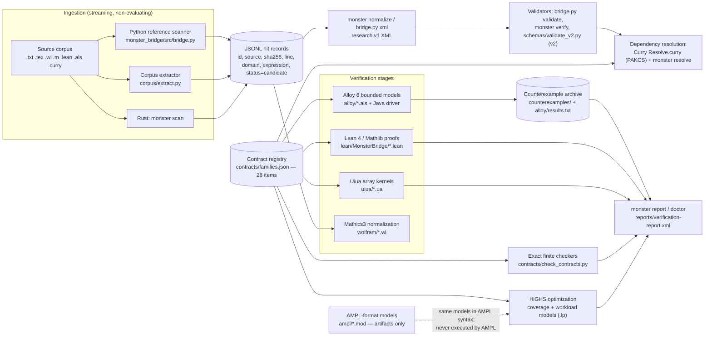

# MONSTER — Mathematical Invariant Discovery & Verification Engine

**MONSTER-BRIDGE.** A deterministic, XML-first research engine that connects
symbolic mathematics (Mathics3 / Wolfram Language), logic programming
(Curry / PAKCS), relational bounded verification (Alloy 6), formal proof
(Lean 4 / Mathlib), array computing (Uiua), and constraint optimization
(HiGHS, with AMPL-format models as artifacts) under a single Rust
orchestration CLI, so that a mathematical claim extracted from source
material carries its provenance, its dependency structure, and an honestly
graded verification status through every stage of the pipeline.

The engine ingests mathematical source material, extracts candidate
structures by streaming lexical analysis, records them in a versioned XML
contract format, classifies the candidates into mathematical contract
families (Monster Group, monstrous moonshine, Lie algebras, recursive
geometry, and the dependency model itself), resolves their dependency
relationships by Horn-clause reasoning, searches for counterexamples in
bounded relational models, checks selected finite instances exactly, proves
abstract theorems formally, computes numerical residuals with array
kernels, and prioritizes verification work by optimization. Extracted text
is never executed, and raw extracted text is always a *candidate*, never a
theorem. Every result is reported in a five-value vocabulary — `VERIFIED`,
`COUNTEREXAMPLE`, `UNPROVEN`, `UNSUPPORTED`, `EXECUTION_FAILED` — and no
bounded check or numerical measurement is promoted into a proof anywhere in
the system.

This README documents the system as built and measured. The full evidence
base is in `reports/IMPLEMENTATION-REPORT.md` and the per-phase reports in
`reports/`; the machine-readable counterpart is
`reports/verification-report.xml`, which validates under the repository's
own contract validator. The master test pass (`scripts/run-all-tests.sh`)
re-runs twelve subsystem suites end to end; the final recorded pass is
12/12 suites, 0 failed (`tests/master-test-run.txt`).

## A. Project Identity

**MONSTER — Mathematical Invariant Discovery & Verification Engine**
(repository name: MONSTER-BRIDGE; orchestration binary: `monster`).

The subject matter is the mathematics surrounding the Monster group — the
largest sporadic finite simple group — and monstrous moonshine, the
established correspondence between the Monster's representation theory and
the Fourier coefficients of the modular $J$-function. The engine does not
compute with the Monster itself: the group has order approximately
$8.08 \times 10^{53}$, no validated Monster character table or generator
set is an input to this system, and the Monster appears in the contract
registry only as an explicitly unsupported abstract item. What the engine
computes with is the *structure around* such claims: finite test instances
(the symmetric group $S_3$, the Lie algebra $\mathfrak{so}(3)$, the cyclic
action of $C_4$), published numerical data (the first coefficients of the
$J$-function and McKay's identity), finite relational abstractions, and
abstract theorems about arbitrary groups, actions, homomorphisms, and
brackets satisfying stated hypotheses.

Three design commitments run through every subsystem:

1. **Provenance is part of the data.** Every claim record carries its
   source identifier, the SHA-256 of its source, its line number, its
   assumptions, and its status. A claim whose evidence is deleted or whose
   source cannot be resolved is rejected by the validators, not silently
   carried.
2. **Status is earned, and the gate is mechanical.** A claim may be marked
   `verified` only when it carries formal-proof evidence from a proof
   assistant (Lean, Coq, Agda, or Isabelle) with a 64-hex-digit SHA-256
   artifact reference. The validators enforce this rule; bounded Alloy
   results and numerical residuals cannot satisfy it.
3. **Nothing extracted is executed.** Corpus text is untrusted input. The
   scanners read it line by line and record it; no stage evaluates it,
   substitutes it into a shell or a computer-algebra session, or treats it
   as a program.

The repository also preserves, byte-identical and unedited, the owner's
original Python reference implementation under `monster_bridge/` (scanner,
XML exporter, and contract validator). It is the semantic reference for the
Rust CLI: the CLI's scan output is byte-identical to the Python reference
on the seed samples, verified by a differential test described in §O.

## B. Executive Technical Summary

**The problem.** Mathematical literature states invariants — identities,
decompositions, structural laws — whose evidence varies enormously: some
are formally proved, some are published data, some are conjectures, and
some are analogies. A discovery pipeline that mines such material needs to
keep those grades distinct, or it manufactures certainty. The problem this
engine addresses is therefore not "compute the Monster group" but
"extract candidate invariants, attach their provenance and dependencies,
and grade the evidence for each one with tools whose strength is known and
recorded."

**Why invariants matter here.** An invariant is the unit of work. The
contract registry (`contracts/families.json`) states each candidate as a
precise mathematical assertion over a named domain — for example
"composition in $S_3$ is associative for all 216 triples" or "the
$\mathfrak{so}(3)$ bracket satisfies the Jacobi identity on all 27 basis
triples" — together with its scope. Scope is what makes the grading honest:
the first statement is decidable by exhaustion and is verified; the
analogous statement about the Monster is not decidable by any means
available here and is recorded as unsupported, with the reason in the
record.

**Why monstrous moonshine is relevant.** Moonshine supplies the engine's
richest graded example. The normalized $J$-function has
$q$-expansion coefficients that decompose into dimensions of irreducible
Monster representations — beginning with McKay's observation
$196884 = 196883 + 1$. The first coefficients and decompositions are
established published data and are checked here as exact integer
equalities. The full correspondence (the Conway–Norton conjectures, proved
by Borcherds) is established mathematics in the literature, but it is not
re-proved by this engine: the registry records the McKay–Thompson and
modular-invariance items as abstract-only and unsupported for machine
check, because no modular-forms or vertex-operator-algebra library is an
input to the system. The engine thus demonstrates, on real mathematics,
the difference between checking published numbers and proving the theory
behind them.

**How Monster symmetry enters.** The Monster enters in three recorded
ways, none of them a computation on the group itself: (i) its published
representation dimensions $1, 196883, 21296876, 842609326$ appear in the
coefficient decompositions checked in the MOON family; (ii) the abstract
laws any finite group and its representations satisfy — closure,
associativity, inverses, homomorphism composition, character orthonormality
structure — are verified on the finite instance $S_3$ and proved in
abstract form in Lean for arbitrary groups; (iii) the registry item
`MON-monster-abstract` records the group itself as unsupported, with the
reason stated: exhaustive enumeration is impossible at order
$8.08 \times 10^{53}$, and no validated character table or generator set
is an input.

**How Lie groups and manifolds are represented.** Positive-dimensional
geometry is represented at two levels. At the finite level, the Lie
algebra $\mathfrak{so}(3)$ is present as an explicit structure-constant
table (the Levi-Civita symbol) whose antisymmetry and Jacobi identity are
checked exactly over the rationals, and a finite $C_4$ action carries the
group-action composition law. At the proof level, Lean states bracket
consequences from antisymmetry and Jacobi as hypotheses for an abstract
bracket. The genuinely differential-geometric items — tangent-space
consistency, equivariance of smooth actions, coordinate-chart
compatibility — require smooth-manifold machinery that is not an input to
the system and are recorded as unsupported, not approximated.

**What the engine discovers, tests, verifies, and cannot prove.**
It *discovers* candidates: lexical extraction over a corpus produces
provenance-carrying records, and the dependency resolver determines which
candidates are resolvable — whose recorded dependency cone contains no
abstract-only item (20 of 28 registry items; the 8 blocked items are
exactly the abstract-only ones). It *tests* by exact finite computation:
group axioms by exhaustion, character tables, bracket identities, data
equalities (14 registry items verified; 1 deliberate counterexample
detected; 5 geometry items bounded to their concrete instances). It
*verifies* formally: 35 Lean theorems about group actions, representation
composition, bracket consequences, and the soundness of the dependency
model itself (if every dependency edge strictly increases a rank, the
graph has no cycle of any length). It *cannot prove*: anything about the
Monster group itself, the moonshine correspondence, modular transformation
identities, partition-function constraints, differential-geometric claims,
or holographic duality. Each of those is a recorded registry item with
status `UNSUPPORTED` and its reason in the record, so the absence is
auditable rather than silent.

**What makes it reproducible.** Every subsystem ships its runner script
and its recorded output; the synthetic benchmark corpus regenerates
byte-identically from a fixed seed; artifact hashes chain the reports to
the artifacts they describe; and the verification report itself is an XML
document in the repository's own contract format that passes the
repository's own validator — including its single `verified` claim, which
is gated on the SHA-256 of the compiled Lean proof artifact. Toolchain
versions are recorded as printed by the tools themselves in
`reports/toolchain-manifest.md`, and `monster doctor` re-probes the
toolchain on the machine it runs on.

## C. Mathematical Foundations

### C.1 Finite simple groups, sporadic groups, and the Monster

A finite group $G$ is *simple* when its only normal subgroups are the
trivial subgroup and $G$ itself. The classification of finite simple
groups places every finite simple group into infinite families (cyclic,
alternating, Lie type) plus 26 exceptional *sporadic* groups. The largest
sporadic group is the **Monster group** $\mathbb{M}$, of order

$$
|\mathbb{M}| = 808017424794512875886459904961710757005754368000000000
= 2^{46}\, 3^{20}\, 5^{9}\, 7^{6}\, 11^{2}\, 13^{3}\, 17 \cdot 19 \cdot 23
\cdot 29 \cdot 31 \cdot 41 \cdot 47 \cdot 59 \cdot 71
\approx 8.08 \times 10^{53}.
$$

(The decimal value is recorded as published data in
`corpus/samples/established-facts.txt`; the factored form above is the
standard published factorization.) The size of the group is the operative
fact for this engine: no enumeration of $\mathbb{M}$, its elements, or its
conjugacy classes is computationally possible, and none is attempted.

A *representation* of a finite group $G$ is a homomorphism
$\rho : G \to GL(V)$; its *character* is the class function
$\chi_\rho(g) = \operatorname{Tr} \rho(g)$, constant on conjugacy classes.
Irreducible characters are orthonormal under the class-weighted inner
product $\langle \chi, \psi \rangle = \frac{1}{|G|} \sum_{g \in G}
\chi(g) \overline{\psi(g)}$, and the dimensions of the irreducibles satisfy
$\sum_i d_i^2 = |G|$. The contract checkers verify this structure on the
instance $S_3$: characters trivial, sign, and standard
($\chi(p) = \operatorname{fix}(p) - 1$) are constant on the conjugacy
classes (sizes $[1, 2, 3]$), pairwise orthonormal, and
$1^2 + 1^2 + 2^2 = 6 = |S_3|$.

A *group action* of $G$ on a set $X$ assigns to each $g \in G$ a map
$x \mapsto g \cdot x$ satisfying the two laws the engine checks and proves:

$$
1 \cdot x = x, \qquad (gh) \cdot x = g \cdot (h \cdot x).
$$

Composition laws of this shape — for actions, and for homomorphisms,
$\rho(gh) = \rho(g)\rho(h)$ — are the engine's most reused invariants:
they are exhausted on finite instances by the contract checkers, modeled
relationally in Alloy, and proved in Lean both for Mathlib's `MulAction`
and for a hand-rolled action structure whose only assumptions are the two
law fields.

### C.2 Monstrous moonshine and the $J$-function

Let $\tau$ lie in the upper half-plane and $q = e^{2\pi i \tau}$, so
$0 < |q| < 1$. A *modular function* is a meromorphic function on the upper
half-plane invariant under the modular group $SL(2, \mathbb{Z})$,
generated by $T : \tau \mapsto \tau + 1$ and $S : \tau \mapsto -1/\tau$,
and meromorphic at the cusp. The $j$-invariant is the modular function
with a single simple pole at the cusp and $q$-expansion

$$
j(\tau) = q^{-1} + 744 + 196884\,q + 21493760\,q^{2} + 864299970\,q^{3} + \cdots
$$

The **normalized $J$-function** is $J(\tau) = j(\tau) - 744$, with constant
coefficient $0$:

$$
J(\tau) = q^{-1} + 196884\,q + 21493760\,q^{2} + 864299970\,q^{3} + \cdots
$$

The Frenkel–Lepowsky–Meurman moonshine module is a graded
vertex-operator-algebra representation
$V^{\natural} = \bigoplus_{n \geq 0} V^{\natural}_n$ of the Monster, graded
so that $J(\tau) = \sum_{n \geq 0} \dim V^{\natural}_n \, q^{\,n-1}$.
McKay's observation — the observation that started moonshine — is that the
first nontrivial graded dimension decomposes into irreducible Monster
dimensions:

$$
196884 = 196883 + 1,
$$

where $196883$ is the dimension of the smallest nontrivial irreducible
representation of $\mathbb{M}$ and $1$ is the trivial dimension. The next
coefficients decompose likewise, and the engine checks these as exact
integer identities:

$$
21493760 = 1 + 196883 + 21296876, \qquad
864299970 = 2\cdot 1 + 2\cdot 196883 + 21296876 + 842609326.
$$

For each $g \in \mathbb{M}$, the **McKay–Thompson series** is the graded
trace $T_g(\tau) = \sum_{n \geq 0} \operatorname{Tr}(g \,|\, V^{\natural}_n)
\, q^{\,n-1}$; for $g = 1$ it reduces to $J(\tau)$. The Conway–Norton
conjectures assert that every $T_g$ is a *Hauptmodul* — a generator of
the function field — for a genus-zero subgroup of $SL(2, \mathbb{R})$;
Borcherds proved the conjectures, and monstrous moonshine is established
mathematics. The engine's position on it is precise: the published
coefficients, McKay's identity, and the two decompositions above are
checked as data; the correspondence itself is not re-proved and its
registry items are abstract-only.

### C.3 Lie groups, Lie algebras, and manifolds

A *Lie group* is a group that is also a smooth manifold, with smooth group
operations. Its *Lie algebra* is the tangent space at the identity
$T_e G$, equipped with the Lie bracket $[\,\cdot\,,\,\cdot\,]$, a bilinear
operation satisfying antisymmetry and the **Jacobi identity**:

$$
[x, y] = -[y, x], \qquad
[x, [y, z]] + [y, [z, x]] + [z, [x, y]] = 0.
$$

In a basis $\{e_i\}$ the bracket is determined by *structure constants*
$[e_i, e_j] = \sum_k c_{ij}{}^{k}\, e_k$. The engine's concrete instance is
$\mathfrak{so}(3)$, where $c_{ij}{}^{k} = \varepsilon_{ijk}$ is the
Levi-Civita symbol: $[e_0, e_1] = e_2$, $[e_1, e_2] = e_0$,
$[e_2, e_0] = e_1$. Its 9 basis-pair antisymmetry checks and 27 basis-triple
Jacobi checks are computed exactly over the rationals with maximum residual
exactly $0$. Two honesty points are built into the artifacts. First,
antisymmetry alone yields only $[x, x] + [x, x] = 0$ — a 2-torsion
statement — and the Lean development proves exactly that as its headline,
proving $[x, x] = 0$ only under an explicit no-2-torsion hypothesis.
Second, a *smooth group action* $G \times M \to M$ on a manifold, its
*equivariance* condition $f(g \cdot x) = g \cdot f(x)$ for structure maps
$f$, tangent-space consistency under left translation, and chart
compatibility on overlaps are differential-geometric statements; the
engine checks only the finite shadow of the action law (the $C_4$ action
on four vertices, 64/64 triples) and records the smooth items as
unsupported.

### C.4 Holographic connections — established results versus speculation

The moonshine module $V^{\natural}$ is a holomorphic conformal field
theory of central charge 24, and partition functions of the form
$Z(\tau) = \operatorname{Tr} \, q^{L_0 - c/24}$ are the bridge by which
moonshine mathematics is discussed alongside two-dimensional conformal
field theory. In gravitational physics, holographic duality (AdS/CFT)
relates a conformal field theory on a boundary to a gravitational theory
in the bulk, and Monster-symmetric conformal field theories have been
discussed in that literature as candidate boundary theories. That is the
extent of the factual connection. What is established: the moonshine
correspondence itself (§C.2), and the existence and properties of
$V^{\natural}$ as a vertex operator algebra. What is speculative: any
specific holographic interpretation of Monster symmetry, and any claim
connecting it to a simulation hypothesis. **This engine produces no
evidence for holographic duality, claims none, and does not treat Monster
Group symmetry as proving the holographic principle or any simulation
hypothesis.** The registry item `GEO-holographic-scope` is abstract-only
with status `UNSUPPORTED` and that reason recorded in the record itself.

## D. System Architecture

The architecture is a file-artifact pipeline, not a service mesh. Stages
communicate through JSONL hit records, XML contract documents, JSON
registries, and recorded output files; each stage's runner script
regenerates its outputs from its inputs, and the Rust CLI orchestrates the
stages that have CLI counterparts and reports on the rest. Only
integrations that were executed appear as solid flows.



Component responsibilities and their operational state, per the
implementation report:

| Component | Responsibility | State in this system |
|---|---|---|
| Mathics3 / Wolfram Language | Symbolic normalization and coefficient extraction over recorded expressions | Installed, executed, integrated via `wolfram/` scripts; capability map measured (§F, §O) |
| Curry / PAKCS | Horn-clause dependency resolution with derivation trees and bounded cyclic search | Installed (recovered in Phase 1), executed, integrated via `curry/resolution/` |
| Alloy 6 | Bounded counterexample search over finite relational abstractions | Executed headlessly via a Java driver; results archived in `counterexamples/`; the CLI reads recorded results and does not run the solver |
| Lean 4 / Mathlib | Formal verification of abstract theorems and dependency-model soundness | Installed, executed (`lake build`), integrated as the proof archive `lean/` + `proofs/` |
| Uiua | Array kernels: Jacobi residuals, coefficient arithmetic, transform round-trips, equivariance residuals | Installed, executed, cross-checked against an independent Python checker |
| AMPL / HiGHS | Optimization of verification workloads: task selection, dependency coverage | HiGHS installed and executed on LP/MPS models; AMPL-format `.mod` files are authored artifacts — **the AMPL runtime is not installed and no `.mod` file has been executed by AMPL** |
| Rust | Orchestration: scan, normalize, classify, resolve, contract, counterexample reporting, verify, evaluate, report, doctor | Built and differentially tested against the Python reference |

## E. Repository Directory Map

Tree generated from the tracked file set (`git ls-files`), with build
products excluded by `.gitignore` (`lean/.lake/`, `rust/target/`,
`corpus/synthetic/`, the benchmark hits file) and generated Curry caches
elided:

```
monster-engine/
├── README.md  STATUS.md  LICENSE  .gitignore
├── directive/MONSTER-BRIDGE-DIRECTIVE.md        # the governing directive, verbatim
├── monster_bridge/                              # owner seed (Python reference, byte-identical)
│   ├── src/bridge.py                            # scan / xml / validate
│   ├── schema/contract.xsd                      # schema v1
│   ├── samples/                                 # moonshine.txt, hits.jsonl, contracts.xml
│   └── scripts/test.sh
├── schemas/                                     # contract schema v2
│   ├── contract-v2.xsd  validate_v2.py  TYPED-AST.md
│   ├── examples/                                # 1 valid + 5 invalid documents
│   └── run_tests.sh  test-output.txt
├── corpus/
│   ├── extract.py  gen_synthetic.py
│   └── samples/established-facts.txt  (+ .hits.jsonl)
├── contracts/
│   ├── families.json                            # the 28-item registry
│   ├── check_contracts.py  run_checks.sh  check-output.txt
├── curry/
│   ├── battery/                                 # Phase 1 §3 verification battery (7 programs + outputs)
│   └── resolution/                              # Resolve.curry, Facts.curry, MoonshineChain.curry,
│                                                # FactsCyclic.curry, gen_facts.py, check.py, run.sh, outputs/
├── alloy/
│   ├── *.als                                    # 6 valid-form modules + 6 _bad negative variants
│   ├── driver/RunAlloy.java                     # headless Alloy driver
│   └── run_all.sh  results.txt
├── counterexamples/                             # INDEX.md + one JSON record per Alloy module
├── lean/
│   ├── lakefile.lean  lean-toolchain  MonsterBridge.lean
│   └── MonsterBridge/                           # GroupAction, Representation, LieBracket, DependencyModel
├── proofs/                                      # README.md, axioms.txt, lean-build-log.txt
├── uiua/                                        # jacobi.ua, jcoeff.ua, transforms.ua, equivariance.ua,
│                                                # check.py, run_all.sh, outputs/
├── wolfram/                                     # normalize.wl, capabilities.wl, run.sh, outputs/
├── ampl/
│   ├── coverage.lp  coverage.mod  coverage_brute.py  run_coverage.sh  coverage-run.txt
│   ├── workload.mod                             # AMPL-format artifact (not executed)
│   └── verification/                            # workload.lp/.mps, highs-run.txt, highs-solution.txt, README.md
├── rust/
│   ├── Cargo.toml  Cargo.lock  README.md
│   ├── src/main.rs                              # the monster CLI (std-only)
│   └── tests/families.fixture.json
├── benchmarks/                                  # corpus-benchmark.md/.txt, uiua-benchmark.txt
├── scripts/                                     # run-all-tests.sh, difftest.sh, reinstall-swi.sh
├── tests/                                       # README.md, master-test-run.txt
└── reports/                                     # IMPLEMENTATION-REPORT.md, phase*.md,
                                                 # toolchain-manifest.md, verification-report.xml
```

Per-directory detail:

| Directory | Purpose | Important files | Language | Entry point | Inputs → outputs | Verification status |
|---|---|---|---|---|---|---|
| `monster_bridge/` | Owner's Python reference: streaming scanner, XML exporter, semantic validator | `src/bridge.py`, `schema/contract.xsd` (v1), `samples/` | Python 3 | `bash monster_bridge/scripts/test.sh`; `python3 src/bridge.py scan\|xml\|validate` | corpus tree → JSONL hits → v1 XML → validation verdict | Suite green (4 records per stage); preserved byte-identical, never edited by the build |
| `schemas/` | Contract schema v2: full §4 field set, typed-AST design, validator | `contract-v2.xsd`, `validate_v2.py`, `TYPED-AST.md`, `examples/` | XSD + Python | `bash schemas/run_tests.sh` | v2 XML documents → accept/reject with a specific error class | 7/7 tests: 1 valid accepted; malformed, unsupported operator, unresolved reference, dependency cycle, unsubstantiated `verified` all rejected |
| `corpus/` | Streaming extraction beyond the seed (adds geometry and modular families) and the synthetic benchmark generator | `extract.py`, `gen_synthetic.py`, `samples/established-facts.txt` | Python 3 | `python3 corpus/extract.py <root> <out.jsonl>` | corpus tree → JSONL records with `rule`, `offset`, `encoding` fields added to the seed's record shape | Record-for-record equal to the seed on the seed samples; recall exact on the synthetic benchmark (§O) |
| `contracts/` | The contract registry and its exact finite checkers | `families.json`, `check_contracts.py`, `run_checks.sh`, `check-output.txt` | JSON + Python | `bash contracts/run_checks.sh` (nonzero exit on any expected/actual mismatch) | registry → one status line per item (28 lines) | 28/28 expected = actual: 14 VERIFIED, 1 COUNTEREXAMPLE, 5 BOUNDED, 8 UNSUPPORTED (§G) |
| `curry/` | Curry verification battery and Horn-clause dependency resolution | `battery/*.curry`, `resolution/Resolve.curry`, `resolution/check.py` | Curry (PAKCS) + Python | `bash curry/resolution/run.sh`; battery sessions recorded in `battery/outputs/` | `families.json` → generated `Facts.curry` → derivation trees, resolvable/blocked sets | Battery 7/7 (§I); resolution agrees with the independent checker on all comparisons |
| `alloy/` | Bounded relational models: group actions, representation composition, moonshine dependencies, Lie-algebra abstraction, geometry contracts, verification states — each with a deliberate negative variant | `*.als` (12 files), `driver/RunAlloy.java`, `run_all.sh`, `results.txt` | Alloy + Java | `bash alloy/run_all.sh` | `.als` modules → per-command SAT/UNSAT with scope, time, instance summary | 41/41 commands as expected (§J) |
| `counterexamples/` | Archive of the Alloy run: index with readings of each counterexample, one JSON per module | `INDEX.md`, `*.json` | JSON/Markdown | — (record) | recorded from `alloy/results.txt` | Contents match the executed run |
| `lean/` | Lean 4 / Mathlib proof project | `MonsterBridge/{GroupAction,Representation,LieBracket,DependencyModel}.lean`, `lakefile.lean`, `lean-toolchain` | Lean 4 | `cd lean && lake build` | sources → compiled oleans | Build succeeds; 35 theorems; zero `sorry`/`admit`; axioms audited (§K) |
| `proofs/` | Proof archive: statements, axiom audit, build log | `README.md`, `axioms.txt`, `lean-build-log.txt` | Markdown/text | — (record) | — | The compiled `DependencyModel.olean` is the artifact the verification report's `verified` claim is gated on (SHA-256 in `STATUS.md`) |
| `uiua/` | Array kernels and their independent cross-checker | `jacobi.ua`, `jcoeff.ua`, `transforms.ua`, `equivariance.ua`, `check.py`, `run_all.sh` | Uiua + Python | `bash uiua/run_all.sh` | kernels → printed residuals in `outputs/`, cross-checked values | 17/17 cross-checks pass (§L) |
| `wolfram/` | Mathics3 symbolic normalization and a capability probe with explicit failure reporting | `normalize.wl`, `capabilities.wl`, `run.sh`, `outputs/` | Wolfram Language (Mathics3) | `sh wolfram/run.sh` (invokes `mathics -f <file>.wl`) | expressions and published coefficient data → normalized forms, exact rational ratios, SUPPORTED / CAPABILITY_FAILURE lines | PASS: all required operations supported; three operations recorded as capability failures (§O) |
| `ampl/` | Optimization models: verification-workload allocation and dependency coverage | `verification/workload.lp` (+ `.mps`), `coverage.lp`, `coverage.mod`, `workload.mod`, `coverage_brute.py`, `run_coverage.sh` | LP/MPS (executed by HiGHS), AMPL syntax (artifacts) | `bash ampl/run_coverage.sh` | models → solver status, objective, solution | HiGHS optima agree with hand enumeration (27) and brute force (20) (§M); `.mod` files never executed by AMPL |
| `rust/` | The `monster` orchestration CLI, standard library only | `src/main.rs` (1,645 lines), `Cargo.toml`, `tests/families.fixture.json` | Rust | `cargo build`, `cargo test` in `rust/` | JSONL/XML/JSON artifacts → one JSON object per command on stdout | `cargo test` 14/14; differential test vs the Python seed 8/8 (§O) |
| `benchmarks/` | Measured benchmark records | `corpus-benchmark.md`, `corpus-benchmark.txt`, `uiua-benchmark.txt` | text | — (record) | — | Values as measured; conditions stated in each file |
| `scripts/` | Top-level runners | `run-all-tests.sh` (master pass), `difftest.sh` (Rust vs Python), `reinstall-swi.sh` (toolchain recovery after a VM replacement) | Bash | `bash scripts/run-all-tests.sh` | — | Master pass 12/12 (§O) |
| `tests/` | Master-pass transcript | `master-test-run.txt`, `README.md` | text | — | — | Final recorded pass: 12 suites, 0 failed |
| `reports/` | Phase reports, toolchain manifest, implementation report, machine-readable verification report | `IMPLEMENTATION-REPORT.md`, `phase*.md`, `toolchain-*.md`, `verification-report.xml` | Markdown/XML | — | — | `verification-report.xml` validates under the seed's own validator (12 records) |
| `directive/` | The governing MONSTER-BRIDGE directive, verbatim | `MONSTER-BRIDGE-DIRECTIVE.md` | Markdown | — | — | Preserved as received |

## F. Toolchain Matrix

Versions are as printed by the tools themselves during the build
(2026-10-31 / 2026-11-01), recorded in `reports/toolchain-manifest.md`.
"Executed" means the tool ran in this environment and produced the cited
evidence.

| Tool | Version | Purpose | Installation status | Execution evidence |
|---|---|---|---|---|
| Lean 4 (project toolchain) | `leanprover/lean4` v4.9.0 (via elan) | Formal verification (`lean/` project) | Installed | `lake build` succeeds; `proofs/lean-build-log.txt` |
| Lean 4 (system default) | 4.12.0 (via elan) | Ambient toolchain reported by `monster doctor` | Installed | `monster doctor` output recorded in `reports/phase8-rust.md` |
| Mathlib | v4.9.0 (cache: 4,732 files unpacked) | Proof library dependency of the Lean project | Installed under `lean/.lake/packages` | Lean build log |
| Rust / Cargo | rustc 1.99.0, cargo 1.99.0 (rustup) | Orchestration CLI | Installed | `cargo test` 14/14; differential test 8/8 |
| GCC | 13.3.0 | Native compilation support | Installed | `monster doctor` |
| Java | Temurin 21.0.12.1 (`~/workspace/.tools/jdk-21.0.12.1+1`) | Runs the Alloy jar and headless driver | Installed | Alloy driver runs (41 commands) |
| Alloy | 6 (jar build dated 2025-01-09, `~/workspace/hcalc-counter/alloy.jar`) | Bounded counterexample search | Installed (jar) | `alloy/results.txt`: 41/41 commands as expected |
| Uiua | 0.19.1 (`~/workspace/.tools/uiua/uiua`) | Array kernels | Installed | `uiua/outputs/`; 17/17 independent cross-checks |
| Mathics3 | 10.0.1 (CPython 3.12.3, SymPy 1.14.0, mpmath 1.3.0, numpy 2.5.4) | Wolfram Language symbolic work | Installed (`~/workspace/.tools/mathics-venv/bin/mathics`) | `wolfram/outputs/`; capability map in §O |
| SWI-Prolog | 9.0.4 for x86_64-linux (Ubuntu noble `.deb` set, `dpkg`) | PAKCS backend | Installed | `curry/battery/outputs/0-swipl.txt` |
| PAKCS (Curry) | 3.9.0 of 2025-10-29, SWI 9.0 backend (`~/workspace/.tools/pakcs-3.9.0`) | Horn-clause resolution | Installed (official tarball, SHA-256 recorded in `reports/toolchain-curry.md`) | §3 battery 7/7; resolution suite (§I) |
| HiGHS | 1.15.1, githash 04024d7 (`~/workspace/.tools/highs/bin/highs`) | Optimization solver | Installed (official release binary; archive SHA-256 matches the publisher's digest) | Optima 27 (verification model) and 20 (coverage), §M |
| Python | 3.12.3 | Seed reference, checkers, validators, generators | Installed (system) | All Python suites above |
| GNU time | 1.9 | Benchmark measurement | Installed (`/usr/bin/time`) | `benchmarks/corpus-benchmark.txt` |
| Mathematica / Wolfram Engine | — | — | **Not installed** (commercial). Mathics3 is used instead and is **not** equivalent to Mathematica; its measured capability failures are listed in §O | — |
| AMPL | — | — | **Not installed.** `ampl/*.mod` files are AMPL-format artifacts; none has been executed by an AMPL runtime. Optimization execution is by HiGHS only | — |
| CBC, GLPK | — | — | Not installed; HiGHS is the only solver present | — |
| xmllint | — | — | Not installed; XSD well-formedness is checked with Python `xml.etree`, and the test output says so | — |

## G. Mathematical Contract Registry

The registry is `contracts/families.json`: 28 contract items in four
families (MON 9, MOON 6, LIE 7, GEO 6), joined by 22 `depends_on` edges.
Each item carries a plain-language statement, a kind (`finite-check`,
`identity-check`, `data-check`, or `abstract-only`), and a scope note that
states what the item does *not* cover. The checker is
`contracts/check_contracts.py` (Python 3 standard library only), using
exact integer and `Fraction` arithmetic for the algebraic checks;
`contracts/run_checks.sh` exits nonzero if any actual outcome differs from
the expectation encoded in the checker. Final tally: **14 VERIFIED,
1 COUNTEREXAMPLE, 5 BOUNDED, 8 UNSUPPORTED**, with expected and actual in
agreement on all 28 items (`contracts/check-output.txt`).

| Contract ID | Domain | Invariant (statement as registered) | Implementation | Verification method | Result |
|---|---|---|---|---|---|
| MON-identity | Monster (finite instance) | $S_3$ has a two-sided identity: $e*x = x*e = x$ for all $x$ | `check_contracts.py`, Cayley table built in code from generators $(1,0,2)$, $(1,2,0)$ | Exhaustion, 6/6 elements | VERIFIED |
| MON-closure | Monster (finite instance) | $S_3$ is closed under composition | same | Exhaustion, 36/36 products | VERIFIED |
| MON-associativity | Monster (finite instance) | $(a*b)*c = a*(b*c)$ in $S_3$ | same | Exhaustion, 216/216 triples | VERIFIED |
| MON-inverses | Monster (finite instance) | Every element of $S_3$ has a two-sided inverse in $S_3$ | same | Exhaustion, 6/6 elements | VERIFIED |
| MON-homomorphism | Monster (finite instance) | The sign map $S_3 \to \{+1,-1\}$ is a homomorphism: $\operatorname{sign}(a*b) = \operatorname{sign}(a)\operatorname{sign}(b)$ | same | Exhaustion, 36/36 pairs | VERIFIED |
| MON-nonhomomorphism | Monster (negative test) | The constant map to the transposition $(1,0,2)$ is **not** a homomorphism; a checker must detect the failure | same | Deliberate negative test: failure exhibited at $a = b = (0,1,2)$, where $f(a)f(b) = (0,1,2) \neq (1,0,2) = f(ab)$ | COUNTEREXAMPLE (expected outcome) |
| MON-conjugacy | Monster (finite instance) | Conjugacy classes of $S_3$ partition the group with sizes $[1, 2, 3]$ (class equation) | same | Exact computation of classes | VERIFIED |
| MON-character-compat | Monster (finite instance) | $S_3$ irreducible characters (trivial, sign, standard $\chi(p) = \operatorname{fix}(p) - 1$) are constant on classes, pairwise orthonormal, and $1^2 + 1^2 + 2^2 = 6 = \lvert S_3 \rvert$ | same | Exact rational character arithmetic | VERIFIED |
| MON-monster-abstract | Monster (the group itself) | The Monster group itself: its axioms, homomorphisms, character table, conjugacy classes | none | No machine check: order $\approx 8.08 \times 10^{53}$ makes enumeration impossible, and no validated Monster character table or generator set is an input | UNSUPPORTED |
| MOON-j-coeffs | Moonshine (data) | Published $J$-function coefficients are $\{744, 196884, 21493760, 864299970\}$ | same | Exact integer equality against the established published values | VERIFIED |
| MOON-mckay-identity | Moonshine (identity) | McKay's identity $196884 = 196883 + 1$ | same | Exact integer arithmetic (the arithmetic check does not prove the representation-theoretic reading) | VERIFIED |
| MOON-character-decomposition | Moonshine (data) | $21493760 = 1 + 196883 + 21296876$ and $864299970 = 2\cdot1 + 2\cdot196883 + 21296876 + 842609326$ | same | Exact integer sums against published irreducible dimensions $\{1, 196883, 21296876, 842609326\}$ | VERIFIED |
| MOON-modular-transform | Moonshine (theory) | $J$ is invariant under $S: \tau \mapsto -1/\tau$ and $T: \tau \mapsto \tau + 1$ | none | Analytic statement; no modular-forms library is an input | UNSUPPORTED |
| MOON-mckay-thompson | Moonshine (theory) | For each $g \in \mathbb{M}$, the McKay–Thompson series $T_g$ is the normalized Hauptmodul of a genus-zero group | none | The full moonshine correspondence; far beyond the coefficient data checks | UNSUPPORTED |
| MOON-partition-constraints | Moonshine (theory) | Graded dimensions of $V^{\natural}$ satisfy the partition constraints of its vertex-operator-algebra structure | none | Quantifies over infinitely many graded pieces; requires VOA machinery | UNSUPPORTED |
| LIE-structure-constants | Lie (data) | The $\mathfrak{so}(3)$ bracket table equals the Levi-Civita structure constants $[e_i, e_j] = \sum_k \varepsilon_{ijk} e_k$ | same | Entry-by-entry comparison over the rationals, 9/9 basis pairs | VERIFIED |
| LIE-antisymmetry | Lie (finite instance) | $[x, y] = -[y, x]$ for the $\mathfrak{so}(3)$ bracket | same | Exact rational computation, 9/9 basis pairs, max residual exactly 0 | VERIFIED |
| LIE-jacobi | Lie (finite instance) | $[x,[y,z]] + [y,[z,x]] + [z,[x,y]] = 0$ for $\mathfrak{so}(3)$ | same | Exact rational computation, 27/27 basis triples, max residual exactly 0 | VERIFIED |
| LIE-action-composition | Lie (finite action) | The $C_4$ action (quarter turns) on 4 square vertices satisfies $(g + h) \cdot v = g \cdot (h \cdot v)$ and $0 \cdot v = v$ | same | Exhaustion, 64/64 triples | VERIFIED |
| LIE-tangent-space | Lie (geometry) | $T_e G$ carries the Lie bracket of $G$'s Lie algebra, consistently under left translation | none | Differential-geometric construction; no smooth-manifold machinery is an input | UNSUPPORTED |
| LIE-equivariance | Lie (geometry) | Lie group actions on manifolds are equivariant for the relevant structure maps | none | Equivariance for smooth actions needs differential geometry; the finite $C_4$ law does not establish it | UNSUPPORTED |
| LIE-coordinate-compat | Lie (geometry) | Chart transitions on overlaps satisfy the cocycle condition | none | No atlas or transition-function data is an input | UNSUPPORTED |
| GEO-subdivision | Geometry (concrete grid) | On a dyadic quadtree of the unit square to depth 2, every parent measure equals the sum of its 4 children exactly, and the 16 leaves sum to 1 | same | Exact `Fraction` arithmetic, 5/5 internal nodes | BOUNDED (this grid only) |
| GEO-forward-inverse | Geometry (concrete transform) | The shear $T(x, y) = (x + 2y, y)$ and $T^{-1}(x, y) = (x - 2y, y)$ compose to the identity on the stated test vectors | same | Exact integer computation, residual 0 on 5 test vectors | BOUNDED (this transform only) |
| GEO-tensor-shape | Geometry (concrete shapes) | Shapes $(2,3,4)$, $(4,3,2)$, $(6,4)$, $(24,)$ all have element count 24 | same | Exact count = product of dimensions for each stated shape | BOUNDED (these shapes only) |
| GEO-reconstruction | Geometry (concrete signal) | Upsample-then-downsample of $f(x) = 2x + 1$ on 9 dyadic samples reconstructs with max absolute residual $< 10^{-9}$ | same | Floating-point computation; measured residual 0.0 | BOUNDED (numerical evidence on this signal) |
| GEO-rank-preservation | Geometry (concrete matrix) | Row/column permutations of $\begin{pmatrix}1&2&3\\2&4&6\\1&1&1\end{pmatrix}$ preserve its rank, which is 2 | same | Exact rational elimination | BOUNDED (this matrix only) |
| GEO-holographic-scope | Geometry (scope item) | "Recursive geometry in this engine is related to holographic duality" | none | No check in this system produces evidence for holographic duality; see §C.4 | UNSUPPORTED |

Assumptions, domains, and tolerances, stated once for the whole registry.
The finite instances are named in every scope note — $S_3$ realized as
permutations of 3 elements, $\mathfrak{so}(3)$ on a 3-dimensional real
basis, $C_4$ on 4 vertices, and the named GEO grids, transforms, shapes,
and matrix — and a result about an instance is evidence about that
instance, not about the general object; in particular, $S_3$ results
prove nothing about the Monster. Algebraic checks run in exact integer or
rational arithmetic, so their residuals are exactly 0, not
tolerance-based; the single floating-point check (GEO-reconstruction)
declares its tolerance, $10^{-9}$, in the registry, measured 0.0, and is
classified BOUNDED as numerical evidence on one signal. The MOON data
checks compare recorded values against established published values;
verifying the arithmetic of a decomposition does not prove the
representation-theoretic correspondence behind it, and the registry says
so in the item scopes. Abstract-only items are never silently dropped:
they are carried in the registry, counted in every tally, and reported
UNSUPPORTED with their reasons.

## H. XML Interchange Architecture

Two schema versions coexist, by design. **Version 1** is the owner's seed
format (`monster_bridge/schema/contract.xsd`): a `research` root with
`source` elements (`id`, `path`, `sha256`) and `claim` elements carrying
`expression` and `assumptions` text, optional `dependency` references, and
optional `evidence` entries (`tool`, `status`, `artifact_sha256`, plus a
`details` child). **Version 2** (`schemas/contract-v2.xsd`, root attribute
`version` fixed to `"2"`) carries the full interchange field set: per
source, `title`, `author` elements, `publication-date`, and `provenance`;
per claim, **both** `original-expression` (the expression as transcribed
from the source, retained as auditable evidence) **and**
`normalized-expression` (the typed AST below), `domain` (enumeration:
moonshine, monster, lie, geo, modular-forms, general),
`operator-signatures`, `assumptions`, `variable-scopes`,
`candidate-invariants`, `dependencies`, `evidence`,
`counterexample-evidence` (with report statuses `VERIFIED` /
`COUNTEREXAMPLE` / `UNPROVEN` / `UNSUPPORTED` / `EXECUTION_FAILED`),
`formal-proof-references`, `numerical-residuals`, `toolchain-versions`,
`source-hashes`, and a `verification-report`. Claim status in both
versions is one of `candidate`, `rejected`, `bounded`, `verified`.

**Mathematical AST representation.** A normalized expression is a typed
tree, never an executable string (`schemas/TYPED-AST.md`). Node kinds:
`number` (a `Num` literal stored as decimal text), `symbol` (a `Sym` that
must be declared in the claim's `variable-scopes` or bound by an enclosing
binder), `apply` (an `App` of a registered operator at exactly its
registry arity), `call` (a `Call` of a named function declared in the
claim's scopes), and `binder` (`Bind` for `sum`, `product`, `forall`,
`exists`, `lambda`, `limit`, with the bound name in scope only inside its
body). The operator registry is fixed by the schema — `add`, `subtract`,
`multiply`, `divide`, `power`, `negate`, `equals`, `not-equals`,
`less-than`, `less-or-equal`, `greater-than`, `greater-or-equal`, and
`coefficient` — and three layers must agree (global registry, the
document's `operator-registry`, the claim's `operator-signatures`) before
an operator node is accepted. A document cannot extend the language by
inventing an operator locally; that is an "unsupported operator"
rejection.

**Provenance and integrity.** Every source records the SHA-256 of its raw
bytes (for local files) or, for the two published papers in the schema
example where no digital copy is held, the SHA-256 of the exact
bibliographic locator string — the basis is stated in each `provenance`
element. Extractors hash each file as they stream it, and the corpus
extractor records line numbers and byte offsets per hit. Artifact hashes
chain upward: the reports hash the artifacts they describe, and
`reports/verification-report.xml` is itself a v1 contract document whose
single `verified` claim names the SHA-256 of the compiled Lean
`DependencyModel.olean` it rests on.

**Verification certificates.** There is no free-floating "verified" flag.
Status `verified` is gated, in both validators, on an evidence entry (or,
in v2, a formal-proof-reference entry) whose tool is a proof assistant
(Lean, Coq, Agda, Isabelle), whose status is `verified`, and whose
artifact hash matches the 64-hex pattern. Numerical or bounded evidence
never satisfies the gate. The Alloy `verification_states` modules (§J)
model exactly this rule relationally — and its negative variant produces
a counterexample trace that reaches `Verified` without evidence when the
rule is omitted.

**Numerical result serialization and failure reporting.** Numeric
outcomes are recorded as data: `numerical-residuals` entries carry
`metric`, `value`, `tolerance`, and `tool` attributes as decimal text,
not as evaluated expressions. Validation failures are specific, not
generic: the v2 validator exits 1 with one error class per failure
(malformed XML, unsupported operator, unresolved dependency, dependency
cycle reported as an explicit path such as `c1 -> c2 -> c1`,
unsubstantiated verified), and the v1/Rust validators share the same
message strings for the rules they share (§O, differential test).

**A real example.** The following claim is excerpted verbatim from
`schemas/examples/valid-moonshine.xml`, a document the v2 test suite
accepts (`schemas/run_tests.sh`, 7/7). It records McKay's observation at
status `candidate` with an exact-integer residual of 0 — and its
verification report still says `UNPROVEN`, because exact arithmetic is
not a formal proof of the moonshine correspondence:

```xml
<claim id="c4" source="s2" domain="monster" status="candidate">
  <original-expression>196884 = 196883 + 1 (McKay's observation).</original-expression>
  <normalized-expression>
    <apply operator="equals">
      <number value="196884"/>
      <apply operator="add">
        <number value="196883"/>
        <number value="1"/>
      </apply>
    </apply>
  </normalized-expression>
  <operator-signatures>
    <signature operator="equals" arity="2" argument-types="integer, integer" result-type="proposition"/>
    <signature operator="add" arity="2" argument-types="integer, integer" result-type="integer"/>
  </operator-signatures>
  <assumptions>
    <assumption>196883 and 196884 are read as integers. The arithmetic identity alone does not assert the representation-theoretic reading recorded in the candidate invariant.</assumption>
  </assumptions>
  <candidate-invariants>
    <invariant id="inv-mckay-196884" status="candidate">196884 is the dimension of the Griess algebra and 196883 is the dimension of the smallest non-trivial irreducible representation of the Monster group; McKay's observation that the q coefficient 196884 of claim c2 equals 196883 + 1 motivated monstrous moonshine. Recorded as a published observation, not as a proof of moonshine.</invariant>
  </candidate-invariants>
  <dependencies>
    <dependency ref="c2" relation="uses"/>
  </dependencies>
  <evidence tool="published-table" status="candidate" kind="source-check" artifact_sha256="e16aab3a1848c4e5e3e06e151d9ae72f4f2c8434f575d038740fbf2e4c3ae118">
    <details>Observation as published in the source recorded as s2. No formal proof artifact is claimed; the moonshine correspondence is not established by this arithmetic identity.</details>
  </evidence>
  <numerical-residuals>
    <residual metric="196884 - (196883 + 1)" value="0" tolerance="0" tool="exact integer arithmetic"/>
  </numerical-residuals>
  <toolchain-versions>
    <toolchain name="python" version="3.12.3"/>
    <toolchain name="monster-bridge-validator" version="2"/>
  </toolchain-versions>
  <source-hashes>
    <hash algorithm="sha256" role="source" digest="e16aab3a1848c4e5e3e06e151d9ae72f4f2c8434f575d038740fbf2e4c3ae118"/>
  </source-hashes>
  <verification-report status="UNPROVEN" tool="monster-bridge-validator">
    <details>The integer identity is exact (residual 0), and exact arithmetic is not a formal proof of the moonshine correspondence. The representation-theoretic interpretation remains a published observation in this record.</details>
  </verification-report>
</claim>
```

**Unicode and the Uiua expressions.** Uiua source code is written in
Unicode glyphs, and the interchange format never embeds glyph code as an
expression string. Mathematical content crosses the XML boundary only as
(a) typed AST nodes built from *named* operators (`add`, `multiply`,
`coefficient`, …) whose meaning is fixed by the registry rather than by a
glyph, and (b) decimal-literal text in `number` values and residual
entries, stored as exact text rather than parsed from prose. Meaning is
therefore carried by structure — node kinds, operator names, declared
scopes — and does not depend on any glyph surviving an encoding round
trip. The glyph programs themselves live as UTF-8 source files in
`uiua/` (§L), executed by the Uiua interpreter directly; their numeric
results enter the record as residual data. The seed scanner likewise
preserves Unicode source text unchanged in its records.

## I. Recursive Logic and Backtracking

**Why Curry.** The dependency question — "which contract items can
actually be checked, given that some of their dependencies are
abstract-only?" — is a reachability question over a directed graph with
negation (an item is blocked when *any* transitive dependency is
abstract-only). Curry states it declaratively as Horn clauses with free
variables and non-determinism, executes it by backtracking search, and —
unlike a handwritten graph walk — returns the *derivation tree* that
justifies each verdict. If a future redesign of this system moves
dependency arbitration into a persistent proof-carrying service, a
service-oriented execution framework is the natural home for exactly this
role: clause-level arbitration over a fact base, with justifications as
first-class output. In this system the arbitration runs batch-style via
PAKCS, and the same semantics are reimplemented natively in the Rust CLI
(§D), so the two implementations cross-check each other.

**Recovery of the toolchain (Phase 1).** The directive's toolchain check
required Curry via PAKCS, SWI-Prolog, and HiGHS; the first check found all
three uninstalled on a freshly replaced VM. They were recovered from
official sources (SWI-Prolog 9.0.4 via the Ubuntu noble `.deb` set,
PAKCS 3.9.0 from curry-lang.org, HiGHS 1.15.1 from the official release,
each with provenance recorded in `reports/toolchain-curry.md` and
`reports/toolchain-highs.md`), after which the directive's §3
verification battery passed 7/7:

| §3 requirement | Program | Verified behavior |
|---|---|---|
| Startup / arithmetic | REPL session | `pakcs` evaluates `1+2` to `3` |
| Unification | Prelude `++` with free variables | `xs ++ ys =:= [1,2]` via `getAllValues` returns all three splits `[([],[1,2]),([1],[2]),([1,2],[])]` |
| Recursion | `curry/battery/Family.curry` (`ancestor` Horn rules) | `ancestor "amy"` enumerates `["bob","ada","cy","dee","eli"]` |
| Non-determinism | `curry/battery/Coin.curry` | `coin` yields `[Heads, Tails]`; all 4 enumerated pairs of two coins as expected |
| Backtracking | `curry/battery/PermSort.curry` | 6 permutations of `[1,2,3]`; `psort` returns `[[1,2,3]]` |
| Occurs check | `curry/battery/Occurs.curry` | `x =:= N x (L 7)` against a nested term: finite failure observed on all three recorded probes, no value returned; the implementation's occurs-check mechanism is not claimed |
| Cyclic goals | `curry/battery/Cyclic.curry` (+ naive control) | The naive closure is killed by timeout (exit 124); the fuel-bounded `reachN` terminates and returns `["b","a","c","b","a","c","b","a","c"]` |

**The resolution system (Phase 4)** lives in `curry/resolution/`. Facts
are generated from the registry by `gen_facts.py` (28 `item` facts, 22
`dependsOn` edge facts) so the logic program and the registry cannot
drift apart. The core of `Resolve.curry`:

```curry
-- dependsTrans x y : y is reachable from x in one or more steps.
dependsTrans = dependsTrans-base
dependsTrans = dependsTrans-step

checkable = checkable
  where item _ _ k free; k =:= FiniteCheck ? k =:= IdentityCheck ? k =:= DataCheck

blocked = blocked-base
blocked = blocked-step

-- negation as failure at the set level: the blocked set is fully enumerated
-- first (finite: 28 items), then membership decides. This is the sound
-- route: no clause-level negation is used anywhere.
resolvable x | item x _ _ && not (x `elem` getAllValues blocked)
             = True

-- derivation P1 P2 : a rose tree of (item, clause name, substitution,
-- premise, child trees) - the justification for a reachability fact.
derivation = derivation-base
derivation = derivation-step
```

Accessors read fields out of the data constructors with free variables —
for example the resolvable-set print uses
`itemId | item x fam k = x where x, fam, k free` — so the same clause set
serves queries in any argument position. Two auxiliary modules carry the
remaining semantics: `MoonshineChain.curry` walks the chain
`JCoeff1 ← JCoeff2 ← McKayDecomp ← GradedDim` (the published-coefficient
lineage), and `FactsCyclic.curry` states a deliberate cycle (`a ↔ b`)
whose reachability is answered only by the fuel-bounded predicate
`cycTransN`: at fuel 5 from `a` it returns `["b","a","b","a","b","a"]`,
reported as `BOUNDED`, never as an unqualified success.

**Results.** `curry/resolution/run.sh` regenerates the facts, runs the
queries through `pakcs`, and diffs the verdicts against an independent
Python checker (`check.py`) that computes the blocked set by direct
fixpoint over the registry JSON. All comparisons agree: **28/28 item
verdicts, 8/8 blocked (exactly the abstract-only items), 20/20
resolvable**, root cause of each blockage printed; a negative test
(changing one expected verdict) makes the checker exit 1, so agreement is
not vacuous. The derivations printed are proof-shaped objects: for
example, the tree justifying that `MON-character-compat` is checkable
runs through `dependsTrans-step` from `MON-conjugacy`, then
`dependsTrans-base` to `MON-closure` and `MON-inverses`, each node
annotated with its clause name and substitution. One caveat is printed in
the phase report and applies here: derivations are only as trustworthy as
the classifications in `families.json` — those classifications are data,
not theorems.

## J. Alloy Counterexample Verification

**Why Alloy.** The contract checkers exhaust concrete instances; Alloy
checks the *abstractions* — the shapes of group actions, homomorphism
composition, dependency labelings, bracket tables, subdivision forests,
and verification-state machines — over all small relational structures.
Alloy performs bounded model checking against a solver (here the default
SAT backend of the Alloy 6 jar), driven headlessly: a small Java program
(`alloy/driver/RunAlloy.java`, built against the jar's own API) loads each
module, executes every `check` and `run` command, and records
satisfiability, scope, solver time, and an instance summary in
`alloy/results.txt`. The archive of the run — one JSON record per module
plus readings of the counterexamples — is in `counterexamples/`.

**Modules and outcomes.** Twelve modules: six valid-form models and six
`_bad` negative variants with a deliberate defect injected. Aggregate:
**41 commands (26 checks, 15 runs), 41/41 as expected**; valid-form checks
**16/16 UNSAT in scope**; negative targeted checks **7/7 SAT** (each
returning the counterexample the defect was designed to admit); negative
sanity checks 3/3 UNSAT; runs 15/15 SAT. Total solver time 40,457 ms.

| Module | What it models | Key outcome |
|---|---|---|
| `group_action.als` | Group action laws (identity, compatibility) as relations over atoms | 3 checks UNSAT, 1 run SAT (scope 3) |
| `group_action_bad.als` | Same, with the compatibility axiom weakened | Compatibility check **SAT**: a counterexample where one generator acts as a transposition while its square acts trivially |
| `representation_composition.als` | Composition of homomorphisms is a homomorphism (pure equational consequence) | UNSAT at scope 3 |
| `representation_composition_bad.als` | One factor not homomorphic | Check **SAT**: explicit instance (EA=2, EB=3, EC=2) with non-homomorphic `h` |
| `moonshine_dependencies.als` | Dependency chain `JCoeff1 ← JCoeff2 ← McKayDecomp ← GradedDim`; established items may not depend on conjectures | Consistency check UNSAT |
| `moonshine_dependencies_bad.als` | Same, with an injected inconsistent labeling | Both checks **SAT**, each returning the inconsistent labeling — the model's vocabulary is not over-constrained |
| `lie_algebra_abstraction.als` | $\mathfrak{sl}(2)$ over $\mathbb{F}_5$ with the bracket table pinned from basis `{H,E,F}`: $[H,E]=2E$, $[H,F]=-2F$, $[E,F]=H$ | Antisymmetry, self-bracket, Jacobi checks all UNSAT |
| `lie_algebra_abstraction_bad.als` | One table entry perturbed ($kk[H][E]$: $2 \to 1$, antisymmetric partner $-2 \to -1$) | Jacobi check **SAT**: the perturbed table is returned as the counterexample; its Jacobi component computes $c \cdot (a + b) = 1 \cdot (1 - 2) = -1 \neq 0$ |
| `geometry_contracts.als` | Cell forest with a subdivision sum rule (parent = sum of children) | Two-level unfolding and root-conservation checks UNSAT (scope 5 cells, 6-bit ints) |
| `geometry_contracts_bad.als` | Sum rule broken | Check **SAT**: a 3-cell non-conserving subdivision |
| `verification_states.als` | The evidence-gate state machine: statuses {Candidate, Bounded, Verified, Rejected}; Verified requires evidence; Rejected is absorbing; Verified never regresses | 3 checks UNSAT at 4 states |
| `verification_states_bad.als` | Same, gate rule omitted | Check **SAT**: a 4-state trace reaching `Verified` *without* evidence — the negative control for the owner's evidence-gate rule |

**What a bounded check is and is not.** A `check` returning UNSAT means:
no counterexample exists *within the stated scope* (3–5 atoms, 6-bit
integers, as recorded per command in `alloy/results.txt`). Bounded models
detect specification errors and logic drift cheaply, and the negative
variants prove the models can actually fail — but **UNSAT in a bounded
scope is not an unrestricted proof**, and nothing in this system reports
it as one. Unbounded statements are the Lean development's job (§K); the
Rust CLI's `counterexample` command reads only these recorded results and
never runs a solver.

## K. Lean Formal Verification

The Lean project (`lean/`) is a Lake project on toolchain
`leanprover/lean4:v4.9.0` with Mathlib v4.9.0 as its only dependency. It
formalizes the abstract layer: theorems that hold for *arbitrary* groups,
actions, homomorphisms, and brackets satisfying stated hypotheses, plus
the soundness of the dependency model the whole engine relies on.
`lake build` succeeds; the project contains **35 theorems** and **zero
`sorry` / `admit`** (grep-audited; the build log is
`proofs/lean-build-log.txt`). The root module `MonsterBridge.lean` imports
the four files below. Names are given unqualified; each file's namespace
is `MonsterBridge.<File>`.

**`GroupAction.lean` (11 theorems).** Part A restates the action laws for
Mathlib's `MulAction` (`one_act`, `mul_act`). Part B defines a hand-rolled
structure `HomAction` whose only fields are `act`, `act_one`, `act_mul`,
and derives everything from those two laws alone:

- `inv_act_apply_inv`, `act_apply_inv_act` — acting by $g$ then by $g^{-1}$
  (and conversely) is the identity on points.
- `fixed_by_inv`, `act_bijective` — the action of $g$ is a bijection
  (`Function.Bijective`), and fixedness by $g$ is equivalent to fixedness
  by $g^{-1}$.
- `act_inv_apply`, `inv_act_apply` — the explicit inverse-action formulas.
- `law_one`, `law_mul` — the same laws stated for the structure's own
  projection form.

**`Representation.lean` (7 theorems).** For monoid homomorphisms packaged
as maps with `map_one` / `map_mul` fields (`MonoidHomLike`-free, stated
elementarily so the composition algebra is visible):

- `comp_apply` — composition applies pointwise.
- `comp_map_mul`, `comp_map_one` — the composite preserves multiplication
  and identity, i.e. composition of homomorphisms is a homomorphism.
- `id_comp_repr`, `comp_id_repr`, `comp_assoc_repr` — the identity and
  associativity laws of composition.
- `perm_comp_apply` — permutation composition as the concrete instance.

**`LieBracket.lean` (7 theorems).** From antisymmetry and the Jacobi
identity as hypotheses on an abstract bracket `⟦·,·⟧`:

- `bracket_self_eq_neg_self` — $[x,x] = -[x,x]$.
- `bracket_self_add_self_eq_zero` — $[x,x] + [x,x] = 0$. This is the honest
  headline: antisymmetry alone gives 2-torsion, not $[x,x] = 0$.
- `bracket_self_eq_zero_of_no_two_torsion` — $[x,x] = 0$ under the
  explicit additional hypothesis that the codomain has no 2-torsion.
- `bracket_add_bracket_rev_eq_zero` — $[x,y] + [y,x] = 0$.
- `jacobi_single`, `jacobi_rot` — the Jacobi identity in its stated and
  cyclically rotated forms.
- `bracket_inner_swap` — swapping the inner bracket's arguments negates
  the outer bracket. The Leibniz rule is deliberately *not* stated: it
  does not follow from these hypotheses.

**`DependencyModel.lean` (10 theorems).** The engine's own meta-model:
`HasTopoRank` (every dependency edge strictly increases a natural-number
rank), `IsRankedAcyclic`, and an inductive reachability predicate `Reach`.

- `rank_strict_of_reach` — reachability strictly increases rank.
- `topoRank_no_cycle` — a ranked graph has no cycle of *any* length.
- `topoRank_no_self_loop`, `topoRank_no_two_cycle`,
  `topoRank_no_three_cycle` — the small cases separately.
- `no_topoRank_of_self_loop`, `no_topoRank_of_two_cycle` — no ranking
  exists for a graph containing a self-loop or a 2-cycle.
- `not_rankedAcyclic_of_cycle` — any cycle defeats ranked acyclicity.
- `empty_rankedAcyclic`, `chain01_rankedAcyclic` — the empty graph and the
  two-node chain as positive instances.

**Axiom audit** (`proofs/axioms.txt`, produced with `#print axioms`):

| Theorem | Axioms |
|---|---|
| `MonsterBridge.DependencyModel.topoRank_no_cycle` | **none** — does not depend on any axioms |
| `MonsterBridge.GroupAction.HomAction.act_inv_apply` | `propext` |
| `MonsterBridge.LieBracket.bracket_self_add_self_eq_zero` | `propext` |
| `MonsterBridge.Representation.comp_id_repr` | `propext`, `Quot.sound` |

No headline theorem depends on `Classical.choice` or `sorryAx`. One scope
note is recorded in `proofs/README.md` and applies to the whole section:
these are abstract theorems. Nothing in them establishes that the Monster
group — or any other specific object — satisfies the hypotheses; the
connection to concrete objects is made by the finite checkers of §G, not
by the proofs.

## L. Uiua Array Engine

Uiua (0.19.1) carries the engine's array computations: tensor-shaped
bracket contractions, coefficient arithmetic on the $J$-function data,
transform round-trips, and equivariance residuals. Each kernel in `uiua/`
is run with `uiua run --no-format --no-color`, and every printed value is
independently cross-checked by `uiua/check.py`, which recomputes the same
quantities in Python: **17/17 cross-checks pass**. The full Uiua suite
takes 0.57 s wall-clock (`benchmarks/uiua-benchmark.txt`). Only code that
exists in the kernel files and was executed is quoted here. (Reading note
from the implementation: in Uiua 0.19.1, `- X Y` evaluates to `Y - X`.)

**`jacobi.ua`** stores the $\mathfrak{so}(3)$ structure constants as a
flat 27-element array reshaped to $[3\,3\,3]$, contracts with a
matrix-multiplication primitive built from outer product and reduction,
and forms the three Jacobi terms by index permutation. The Jacobi
residual line of the kernel is:

```uiua
J ← - ⊏[0 2 1]T ⊏[0 2 1]T
/↥ ⌵ ↯[81] J
```

It prints `bracket_e0_e1 = [0 0 1]` and `bracket_e1_e2 = [1 0 0]` (the
$\mathfrak{so}(3)$ table), `jacobi_max_abs_unperturbed = 0`, and — with
one constant deliberately perturbed ($C_{012}$ set to 2) —
`jacobi_max_abs_perturbed = 1`: the kernel detects a broken Jacobi
identity rather than reporting zero unconditionally.

**`jcoeff.ua`** works on the published coefficient vector and derives the
McKay quantity and prefix sums:

```uiua
A ← [744 196884 21493760 864299970]
B ← - 1 ⊏1 A
\+ A
```

`B` is $196884 - 1 = 196883$ (McKay's identity, read off the data);
prefix sums are `[744 197628 21690388 885991358]`. All values in these
computations are below $2^{53}$, so Uiua's float64 arithmetic is exact
here — a property the cross-checker asserts, since the same computation
in floating point would not in general be an exactness argument.

**`transforms.ua`** applies a cyclic permutation matrix to the vector
`[10 20 30]` and back: the round-trip residual is **0** (reversible).
Applying instead the projection $(x,y,z) \mapsto (x,y,0)$ and "inverting"
it by the same map gives residual **9**: the kernel distinguishes an
invertible transform from a lossy one by measurement, which is the finite
shadow of the GEO forward/inverse contract.

**`equivariance.ua`** acts on the matrix $M = \begin{smallmatrix} 1 & 2
\\ 3 & 4 \end{smallmatrix}$ with the Klein four-group of flips — identity,
row flip (`⇌`), column flip (`≡⇌`), both — using Uiua's flip primitives
directly:

```uiua
M ← [1_2 3_4]
Fr ← ⇌ M
Fc ← ≡⇌ M
Fb ← ⇌ ≡⇌ M
```

All three mixed composition residuals are **0** in both orders (the flips
commute, as the group law requires), and each flip is an involution
(residual 0). The contrast case matters as much: flip-rows versus
transpose (`⍉`) gives residual **3**, nonzero — the equivariance check is
not vacuously satisfied by any pair of symmetries.

## M. Optimization

Optimization in this engine schedules *verification work*; it proves
nothing about the mathematics. Both models are solved by HiGHS 1.15.1
from LP files, and both optima are confirmed by solver-independent
enumeration. The same models exist in AMPL syntax (`ampl/workload.mod`,
`ampl/coverage.mod`) as authored artifacts — the AMPL runtime is not
installed and those files have never been executed by AMPL.

**Verification-workload model** (`ampl/verification/workload.lp`, with an
MPS cross-check of the same model). Four verification tasks $t_1..t_4$
with values $10, 9, 13, 8$ compete for a resource budget of 8; task costs
are $3, 2, 4, 3$, and $t_2$ requires $t_1$ ($t_2 - t_1 \le 0$); all
variables binary:

$$
\max \; 10 t_1 + 9 t_2 + 13 t_3 + 8 t_4
\quad\text{s.t.}\quad
3 t_1 + 2 t_2 + 4 t_3 + 3 t_4 \le 8,\;\; t_2 - t_1 \le 0,\;\; t_i \in \{0,1\}.
$$

HiGHS reports **Status Optimal, objective 27**, solution
$\{t_1, t_2, t_4\}$ selected. The model's README enumerates the feasible
sets by hand: $\{t_1,t_2,t_4\}$ costs exactly 8 and scores 27; the next
best, $\{t_1, t_3\}$, scores 23; $\{t_3, t_4\}$ scores 21. The solver's
optimum equals the hand enumeration — this model is the Phase 1 HiGHS
verification, chosen small enough that the optimum is checkable without
trusting the solver.

**Coverage model** (`ampl/coverage.lp`; runner
`ampl/run_coverage.sh`). Twelve named verification tasks (e.g.
`mon_full` cost 7 covering all nine MON items, `moon_data` cost 3,
`lie_full` cost 5, `geo_full` cost 5, `cross_finite` cost 2) with 20
covering constraints — one per checkable registry item — where each
task's coverage set is dependency-closed. HiGHS reports **optimum cost
20** (primal = dual objective 20, MIP gap 0%). The independent check,
`ampl/coverage_brute.py`, parses the LP file itself, asserts its own task
and coverage tables equal the parsed ones (so the model and the
enumeration cannot silently drift), and enumerates all $2^{12} = 4{,}096$
task subsets: the brute-force minimum is also **20**, attained by exactly
two optimal sets, `{mon_full, moon_data, lie_full, geo_full}` and
`{mon_full, moon_data, lie_bracket, lie_action, geo_full}`. The practical
reading: full finite-and-data coverage of the registry costs 20 units
under this cost model, and no cheaper selection covers every checkable
item. (The eight abstract-only items have no covering constraints: no
task in the model makes an abstract item checkable, which is the point.)

## N. Installation and Reproducibility

All paths below are this environment's real paths; every step was
executed during the build. System packages persist in `dpkg`; the
workspace (`~/workspace`) survives VM replacements, and the heavy
toolchains live under `~/workspace/.tools/` for that reason.

**Base toolchain.** elan provides Lean (toolchains v4.9.0 for the project,
4.12.0 as system default); rustup provides cargo/rustc 1.99.0 (the system
cargo on a bare PATH is an older 1.75 — put the rustup cargo first in
PATH, as the master-pass transcript notes); GCC 13.3.0, Python 3.12.3,
and GNU time 1.9 are system packages; Temurin JDK 21 lives at
`~/workspace/.tools/jdk-21.0.12.1+1` (export `JAVA_HOME` to it). The Alloy
6 jar is at `~/workspace/hcalc-counter/alloy.jar`.

**Phase 1 recovery tools** (full provenance in
`reports/toolchain-curry.md` / `reports/toolchain-highs.md`):

```bash
# SWI-Prolog 9.0.4 (Ubuntu noble .deb set, applied with dpkg)
sudo dpkg -i <swi-prolog .deb set>            # or: bash scripts/reinstall-swi.sh

# PAKCS 3.9.0 — unpack the official tarball in place (its build hardcodes
# its own directory) and build against the system swipl
tar xzf pakcs-3.9.0.tar.gz -C ~/workspace/.tools/
cd ~/workspace/.tools/pakcs-3.9.0 && make SWIPROLOG=/usr/bin/swipl

# HiGHS 1.15.1 — official release binary
#   highs-1.15.1-Linux-x86_64.tar.gz → ~/workspace/.tools/highs/bin/highs

# Uiua 0.19.1 — official release binary
#   → ~/workspace/.tools/uiua/uiua
```

**Lean project** (the cache step is the one non-obvious piece: `tar` must
not preserve ownership when unpacking the Mathlib cache, so a shim that
adds `--no-same-owner` goes first in PATH):

```bash
mkdir -p /tmp/tar-shim
printf '#!/bin/sh\nexec /usr/bin/tar --no-same-owner "$@"\n' > /tmp/tar-shim/tar
chmod +x /tmp/tar-shim/tar
cd lean
PATH=/tmp/tar-shim:$PATH lake exe cache get   # "Decompressing 4732 file(s)" / "Completed successfully!"
lake build                                    # succeeds; log in proofs/lean-build-log.txt
```

**Mathics3** runs from its virtual environment; invoke with a file
argument (a bare invocation waits on standard input):

```bash
~/workspace/.tools/mathics-venv/bin/mathics -f wolfram/normalize.wl
sh wolfram/run.sh                              # normalization + capability probe; exit 0
```

**Rust CLI:**

```bash
cd rust && cargo build && cargo test           # 14/14 tests pass
./target/debug/monster doctor                  # probes the toolchain, prints one JSON object
./target/debug/monster scan <corpus> <out.jsonl> [--max-hits N]
./target/debug/monster normalize <in.jsonl> <out.xml>
./target/debug/monster classify <in.jsonl>
./target/debug/monster verify <claims.xml>
./target/debug/monster resolve <claims.xml>
./target/debug/monster evaluate <in.jsonl>
./target/debug/monster contract <families.json>
./target/debug/monster counterexample <module.als>
./target/debug/monster report <dir>
```

Every command prints exactly one JSON object and exits 0 on success, 1 on
a validation or logic failure, 2 on a usage or I/O error. Bare
invocation prints the usage object
`{"error":"usage: monster <scan|normalize|classify|resolve|contract|counterexample|verify|evaluate|report|doctor> [args]"}`.

**Full reproduction.** The master pass re-runs every subsystem suite:

```bash
bash scripts/run-all-tests.sh
# → OVERALL: PASS  (12 suites, 0 failed; transcript tests/master-test-run.txt)
```

Expected per-suite outcomes are tabulated in §O. Two suites are *not*
part of the master pass and are reproduced separately, with their
recorded evidence standing: the one-million-line corpus benchmark
(`python3 corpus/gen_synthetic.py` regenerates the corpus byte-identically
from seed 20261031; measurement procedure in `benchmarks/corpus-benchmark.md`)
and the Phase 1 Curry battery (programs and recorded sessions in
`curry/battery/`).

## O. Benchmarks and Verification Results

All numbers below are measured values copied from the recorded artifacts
named in each row. Anything not measured is marked as such; there are no
estimated figures in this section.

**Master test pass** (`scripts/run-all-tests.sh`; transcript
`tests/master-test-run.txt`): **12 suites, 0 failed**.

| Suite | What it runs | Recorded result |
|---|---|---|
| seed-python-reference | `monster_bridge/scripts/test.sh` — scan, xml, validate over the seed samples | PASS (4 records per stage; domains {moonshine, monster, lie}) |
| xml-v2-validator | `schemas/run_tests.sh` | PASS, 7/7 |
| contracts-checkers | `contracts/run_checks.sh` | PASS, 28/28 (14 VERIFIED / 1 COUNTEREXAMPLE / 5 BOUNDED / 8 UNSUPPORTED) |
| coverage-optimization | `ampl/run_coverage.sh` — HiGHS on `coverage.lp` + brute-force enumeration | PASS, optimum 20 = brute-force 20 |
| highs-verification-model | HiGHS on `ampl/verification/workload.lp` | PASS, Optimal, objective 27 = hand enumeration |
| curry-resolution | `curry/resolution/run.sh` — PAKCS queries + independent checker | PASS, 28/28 verdicts agree; blocked 8/8; resolvable 20/20 |
| alloy-counterexamples | `alloy/run_all.sh` — headless Alloy over 12 modules | PASS, 41/41 commands as expected |
| lean-build | `lake build` in `lean/` | PASS, build succeeds; 35 theorems; 0 sorry/admit |
| uiua-kernels | `uiua/run_all.sh` — 4 kernels + independent cross-checker | PASS, 17/17 cross-checks |
| wolfram-mathics | `wolfram/run.sh` — normalization + capability probe | PASS (capability failures are *reported*, not hidden; see below) |
| rust-cargo-test | `cargo test` in `rust/` | PASS, 14/14 |
| rust-difftest | `scripts/difftest.sh` — Rust CLI vs Python reference | PASS, 8/8 (below) |

**Corpus benchmark** (`benchmarks/corpus-benchmark.md`; measured with
`/usr/bin/time -v`, GNU time 1.9, 4 CPUs, Python 3.12.3; the VM was shared
at 45% CPU during the run, so wall time is an upper bound, not a tuned
figure). Synthetic corpus: 7 files × 150,000 lines = **1,050,000 lines**,
**69,623,312 bytes**, regenerated byte-identically from seed 20261031,
with one planted recognizable line per 50 lines (21,000 planted lines),
every planted line labeled `SYNTHETIC` in its own text.

| Measure | Value |
|---|---|
| Wall clock | 38.97 s (user 17.71 s) |
| Throughput | **26,944 lines/sec** |
| Peak RSS | **19,212 KB** |
| Records produced | 24,016 |
| Recall vs planted ground truth | **Exact per family**: moonshine 6,043; monster 5,010; lie 4,012; geometry 4,895; modular 4,056 — total **24,016 / 24,016** |

The extractor is semantically consistent with the seed scanner: on the
seed's own samples both produce the identical 4 records (the extractor
adds the `rule`, `offset`, and `encoding` fields). Its streaming design
is why peak RSS stays under 20 MB on a 69 MB corpus: files are throttled
line by line and the corpus is never held in memory.

**Rust differential test** (`scripts/difftest.sh`, 8/8):

| # | Comparison | Result |
|---|---|---|
| 1 | Rust `scan` output vs the shipped Python `hits.jsonl` | Byte-identical |
| 2 | Seed `test.sh` still passes | PASS |
| 3 | Rust `verify` accepts the Python-produced XML | PASS |
| 4 | Rust `normalize` output passes the Python validator | PASS |
| 5 | Rust `resolve` on the seed claims (topological order, claim count) | PASS |
| 6 | Rust `evaluate` on the seed hits | PASS |
| 7 | Scan of an adversarial 17-file tree, per-record comparison | Record-identical to the Python scanner |
| 8 | Scan of an empty tree | Both produce 0 records |

**Cargo unit tests** (`rust/`, 14/14): JSON escaping, SHA-256 against the
standard test vectors (empty string, `abc`, the 56-byte vector, one
million `a`s), JSONL parsing and its rejection paths, XML well-formedness
and the evidence-gate rules, the contract checker (including the
deliberate non-homomorphism counterexample), dependency resolution
(acyclic order, cycle detection, missing-dependency error), and the
counterexample lookup's accept/reject paths.

**Alloy run** (`alloy/results.txt`): 41/41 commands as expected — 16/16
valid-form checks UNSAT in scope, 7/7 negative targeted checks SAT with
archived counterexamples, 3/3 negative sanity checks UNSAT, 15/15 runs
SAT; total solver time 40,457 ms, ≈57 s wall including JVM and driver
startup.

**Uiua suite**: 17/17 cross-checks; wall time 0.57 s (`/usr/bin/time -p`:
real 0.57, user 0.06, sys 0.32 — startup-dominated).

**Mathics3 capability map** (`wolfram/run.sh`, by execution — Mathics3 is
not Mathematica, and these failures are recorded rather than worked
around):

| Operation | Status |
|---|---|
| `Expand`, `Factor`, `Coefficient`, `Part` (required) | SUPPORTED — e.g. `Factor[x^2 - 1] = (-1 + x)(1 + x)`; `Coefficient` recovers 744, 196884, 21493760, 864299970 from the recorded polynomial; McKay difference evaluates to 1 |
| `Simplify`, `Series` (optional) | SUPPORTED as evaluated |
| `BitAnd` (all `Bit*` builtins) | **CAPABILITY_FAILURE** — not evaluated by Mathics3 10.0.1 (returns unevaluated) |
| `TestReport` | **CAPABILITY_FAILURE** — not implemented in Mathics3 10.0.1 |
| `VerificationTest` | **CAPABILITY_FAILURE** — not implemented in Mathics3 10.0.1 |

**Not benchmarked.** No throughput or latency figures are claimed for:
the Alloy run beyond its recorded solver/wall times; the Lean build
beyond its recorded log; the Curry resolution beyond its recorded
outputs; end-to-end pipeline latency across all stages; memory use of any
stage other than the corpus extractor. Where a number does not appear in
a recorded artifact, this README does not state one.

## P. Research Findings

The findings separate into the same grades the engine itself assigns.
Nothing from a lower grade is used as evidence for a claim at a higher
grade anywhere in the repository.

**Formally verified (proof-assistant evidence).** The abstract theory is
proved in Lean 4 / Mathlib: group-action consequences from the two action
laws alone (including bijectivity of each action map), composition of
homomorphisms as a homomorphism with its identity and associativity laws,
bracket consequences of antisymmetry and Jacobi — with the honest
2-torsion headline, $[x,x] + [x,x] = 0$, and $[x,x] = 0$ only under an
explicit no-2-torsion hypothesis — and the dependency-model soundness
theorem: if every dependency edge strictly increases a rank function, the
dependency graph contains no cycle of any length. The headline soundness
theorem depends on no axioms; the other audited headlines depend at most
on `propext` and `Quot.sound`; no audited theorem uses `Classical.choice`
or `sorryAx`. These theorems are about arbitrary structures satisfying
the hypotheses; they do not by themselves establish anything about the
Monster group.

**Bounded checks (finite scopes, recorded).** Alloy finds no
counterexample, within scopes of 3–5 atoms and 6-bit integers, to the
modeled group-action laws, homomorphism composition, moonshine dependency
labeling, the pinned $\mathfrak{sl}(2)$ bracket table over
$\mathbb{F}_5$, the subdivision conservation rules, or the evidence-gate
state machine — and every deliberately broken variant *does* produce its
counterexample, archived with readings in `counterexamples/`. The five
GEO contract items are bounded to their concrete grids, transforms,
shapes, signals, and matrices. Bounded results delimit where a
specification fails; they are not unrestricted proofs.

**Exact finite and data checks.** Fourteen registry items are verified by
exhaustion or exact arithmetic: the $S_3$ group axioms, sign
homomorphism, conjugacy classes, and character compatibility; the
published $J$ coefficients, McKay's identity, and the two coefficient
decompositions into published irreducible dimensions; the
$\mathfrak{so}(3)$ structure constants, antisymmetry, and Jacobi identity
over the rationals with residual exactly 0; and the $C_4$ action law. One
deliberate negative test returns its designed counterexample (the
constant map that is not a homomorphism), confirming the checkers detect
failure rather than rubber-stamping it. The Curry resolution agrees with
an independent checker that 20 of 28 registry items are resolvable and
the 8 blocked items are exactly the abstract-only ones; the derivation
trees make each verdict inspectable.

**Numerical evidence.** The Uiua kernels measure residuals: Jacobi
maximum absolute residual 0 unperturbed and 1 under a one-entry
perturbation; transform round-trips 0 where invertible and 9 where lossy;
Klein-flip equivariance residuals 0 with a nonzero (3) contrast case.
Mathics3 evaluates the recorded symbolic normalizations and coefficient
extractions exactly (rational ratios such as $196884/744 = 16407/62$),
within its measured capability map. HiGHS optimization, confirmed by
enumeration, prices full finite-and-data coverage of the registry at 20
cost units and the Phase 1 workload optimum at 27. The corpus benchmark
(§O) measures extraction throughput and exact recall on a synthetic
corpus; synthetic-corpus recall is evidence about the extractor, not
about any mathematical claim. Numerical values here support engineering
conclusions; none is promoted to a verification status.

**Unresolved research questions and unsupported items.** The following are
recorded in the registry as abstract-only, status `UNSUPPORTED`, with
reasons — they are open for this system, not quietly omitted:

- The Monster group itself (`MON-monster-abstract`): no enumeration is
  possible at order $\approx 8.08 \times 10^{53}$, and no validated
  Monster character table or generator set is an input. Nothing in the
  engine computes with $\mathbb{M}$.
- The modular transformation identities of $J$ (`MOON-modular-transform`)
  and the full McKay–Thompson / Conway–Norton correspondence
  (`MOON-mckay-thompson`): established mathematics in the literature,
  beyond published coefficients as data, but not re-proved or checked
  here — no modular-forms library is an input.
- Partition constraints over the graded pieces of $V^{\natural}$
  (`MOON-partition-constraints`): infinitely many graded pieces and
  vertex-operator-algebra machinery are required.
- Differential geometry (`LIE-tangent-space`, `LIE-equivariance`,
  `LIE-coordinate-compat`): tangent spaces, smooth equivariance, and chart
  cocycles require smooth-manifold machinery that is not an input.
- Holographic duality (`GEO-holographic-scope`): no evidence is produced
  and none is claimed; see §C.4.
- Whether any lexically extracted candidate invariant, beyond the
  published data already in the registry, corresponds to a real theorem
  remains an open question for future corpus work; the extractor's output
  is candidate-grade by construction.
- Tool-level gaps recorded as capability failures, not substituted:
  Mathematica / Wolfram Engine (not installed), the AMPL runtime (models
  authored only), and Mathics3's `BitAnd`, `TestReport`, and
  `VerificationTest`.

## License

This repository is licensed under the SNAPKITTY OPAQUE SOURCE LICENSE
v1.0 (SPDX-License-Identifier:
`LicenseRef-Sovereign-Leviathan-SL-AGPL3-001`). The full license text is
the `LICENSE` file at the repository root and governs the terms of use.
